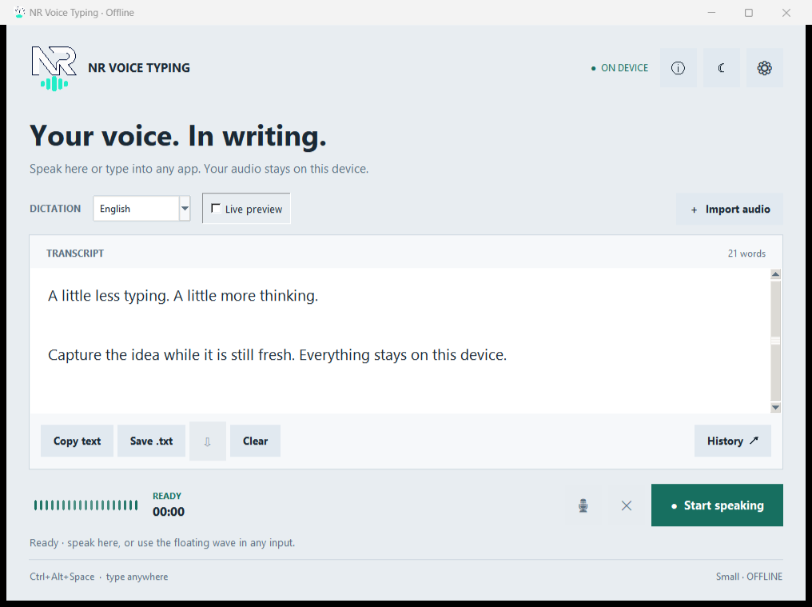

# NR Voice Typing — Offline Voice Typing for Windows

**Version 2.0.0 · English and Dari/Persian · Local speech recognition · MIT**

Turn speech into text in a focused desktop editor or in another application's text box.
NR Voice Typing uses a local Small speech model. After setup, normal dictation works
without an internet connection, account, subscription, or cloud speech service.

> **Accuracy status:** English produced the complete expected sentence in the included
> clear-speech end-to-end test. Dari/Persian support is experimental and currently less
> accurate; no representative Dari accuracy percentage has been established yet.
> Microphone quality, accent, background speech, and room noise can change results.

Developed by **Nooraqa Rasouli — Software Engineer**.
[Developer's GitHub](https://github.com/aryanrasouli491) ·
[Source code](https://github.com/aryanrasouli491/Offline-Voice-Typing) ·
[Report an issue](https://github.com/aryanrasouli491/Offline-Voice-Typing/issues) ·
[MIT License](LICENSE)


## What you can do

- Dictate English or Dari/Persian, including English spoken with a non-native accent.
- Start and stop with a button, a global shortcut, or the transparent floating wave.
- Mute to transcribe immediately, then unmute to continue the same text.
- Use **Resume** after a manual stop to append; a normal new recording replaces the editor.
- Preview provisional text while speaking and receive a complete final transcription.
- Save compressed M4A recordings with English or Dari/Persian filenames.
- Search local history and delete several selected entries together.
- Switch between dark and light themes. Hover over icons to see their purpose.



## Install: three clearly named files

You need a **64-bit Windows computer**, a microphone, and **Python 3.12 (64-bit)**.
Install Python from [python.org](https://www.python.org/downloads/windows/) with
**pip**, **Tcl/Tk**, and the **Python launcher** enabled. A GPU and administrator
access are not required by the app. Allow internet access during initial setup.

Keep the project in a writable folder, such as a folder inside your user account.
Do not run it from inside a ZIP file or from Program Files.

| File | What happens when you double-click it |
| --- | --- |
| **1 - Get Project.cmd** | Downloads the version 2.0.0 source from this GitHub repository into a new `NR Voice Typing 2.0.0` folder beside the file. It works by itself, without the rest of the project or Python. |
| **2 - Get Libraries.cmd** | Creates/reuses the project's Python environment, checks required package versions, installs missing/incompatible packages, then verifies imports and audio decoding. |
| **3 - Get Model and Start.cmd** | Downloads multilingual Small if needed, verifies the installation, and opens the app. If Small is already present, it starts without downloading it again. |

**If you downloaded only Get Project:**

1. Put `1 - Get Project.cmd` in the folder where you want the project.
2. Double-click it and wait for the success message.
3. Open the new `NR Voice Typing 2.0.0` folder.
4. Double-click `2 - Get Libraries.cmd`. Keep its window open until it finishes.
5. Double-click `3 - Get Model and Start.cmd`. The first model download is about 484 MB,
   plus small metadata files. Package downloads need additional space.
6. Wait for the model-ready message, choose your language, and start speaking.

**If you downloaded the full source ZIP:** extract it, open the extracted project,
and start at step 4. You do not need Get Project again.

The standalone downloader is pinned to the **v2.0.0 GitHub tag**. Until the developer
publishes that tag, it reports that the release is unavailable. This local release
preparation does not publish or change the existing GitHub repository.

Existing compatible packages visible to the chosen Python 3.12 installation are
reused. A new environment enables Python's system-site-packages support; new packages
are installed inside this project's `.venv`. Existing environments keep their settings.
Packages from unrelated virtual environments are not copied or modified.
Running Get Libraries again keeps compatible versions and uses pip's download cache.
[Python environment behavior](https://docs.python.org/3.12/library/venv.html) ·
[pip installation behavior](https://pip.pypa.io/en/stable/cli/pip_install/)

Model files go into `runtime/models/small/`. The model comes directly from
[Systran/faster-whisper-small](https://huggingface.co/Systran/faster-whisper-small).
Interrupted downloads can be retried. Complete local model files are reused offline.

## Open the app next time

Double-click **3 - Get Model and Start.cmd**. It reuses the installed model.
For a direct launch without a setup window, use **app/Start NR Voice Typing.vbs**.
You may create a Windows shortcut to either file.

Do not copy `.venv` between computers or installation folders. Recreate it with
Get Libraries after moving to a different machine. Keep your model and data folders.

## Everyday use

1. Choose **English** or **Dari / فارسی**. Choose English even if your English has an accent.
2. Click **Start speaking**. Click **Stop & transcribe** to finish immediately.
3. After a manual stop, **Resume** appears and appends your next recording.
   Starting normally creates a replacement transcript.
4. Click the microphone icon to mute. Captured speech is submitted immediately.
   Unmute continues in order; muted sound is not recorded.
5. To dictate into another app, focus its input and press **Ctrl+Alt+Space**.
   Press again to finish. The floating wave can also start/stop without taking focus.
6. Drag the floating wave to position it; its location is remembered. Right-click for
   its menu. Closing the editor may leave this wave running; choose **Quit** to exit.
7. In History, use Ctrl/Shift to select multiple rows and delete them together.

**Save a voice recording:** after stopping, or while muted, click the download arrow
beside Save .txt. Enter a name such as `My meeting` or `صدای من`.
The default name is `voice001_YYYY-MM-DD_HH-MM-SS`. Recordings are saved in your
Windows **Music/NR Voice Typing Voices/** folder, including when Music is redirected.
Files use mono AAC in M4A at 32 kbit/s, approximately 240 KB per minute.
A repeated filename gets a numeric suffix; existing recordings are never overwritten.
A save contains the current recording session's unmuted audio. Resume begins another
audio session while appending its text.

**Live preview and accuracy:** preview text is provisional. Final transcription uses
the complete segment. Settings offers Fast, Balanced, and Accurate decoding.
The included clear English fixture produced its complete expected sentence in the
end-to-end test. This is a functional result, not a universal accuracy percentage.
Dari/Persian accuracy is currently lower and remains experimental because the project
does not yet have a representative labeled Dari evaluation set. Recognition can make
mistakes, especially with unfamiliar accents, distant voices, or overlapping speakers;
review the result. The speech detector filters non-speech
noise, but it does not identify your voice or exclude all other speakers.
The wave's visual sensitivity is separate from silence detection.
Progress uses model callbacks and locally measured timing; only actual completion
reaches 100%. Each recording session is limited to two minutes.

## Your files and privacy

| Folder | Contents |
| --- | --- |
| `app/` | Desktop source, interface assets, direct launcher, and optional local API |
| `setup/` | Library/model installers, requirements, and installation checks |
| `development/` | Tests and a source-release packaging tool |
| `runtime/models/` | Downloaded models; created locally and excluded from GitHub |
| `runtime/data/` | Your settings, transcript history, logs, and timing calibration |
| `.venv/` | Local Python libraries; excluded from GitHub |

The app processes normal dictation locally. Setup contacts GitHub, PyPI and Hugging Face.
History is stored locally in SQLite; disable history in Settings if you prefer.
Recordings are exported only when you request a save. Logs can contain local file
paths and technical errors; inspect them before sharing.

Back up `runtime/data/` before reinstalling. Exported voices stay in Music independently.
The v2 folder reorganization preserves existing local history and adjusts old model
selection paths. If you select a model outside the project, it remains in that location.

## Troubleshooting

| Problem | What to do |
| --- | --- |
| Get Project says the release is unavailable | Check the connection and the repository's Releases page. Version v2.0.0 must be published first. |
| The download destination already exists | Open that folder and continue setup. The downloader intentionally does not merge or overwrite an installation. |
| Python is missing or the wrong version | Install Python 3.12, 64-bit, with Tcl/Tk and the launcher. Then rerun Get Libraries. |
| Package or model download stops | Check the connection and free disk space, then run the same file again. Keep its window open. |
| Libraries are present but imports fail | Close the app, rename only `.venv` to `.venv-old`, and rerun Get Libraries. If globally shared packages conflict, create an isolated environment with `py -3.12 -m venv .venv`, then rerun Get Libraries. Keep `runtime/` intact. |
| No usable model | Run Get Model and Start, or choose the correct model folder in Settings. |
| Microphone does not record | Enable microphone access for desktop apps in Windows settings and select the correct microphone in the app. |
| Text does not reach another app | Refocus its input. Try Clipboard paste or Unicode typing in Settings. A normal app cannot type into an elevated/admin-only window. |
| Shortcut is already used | Choose another supported shortcut in Settings. |
| App does not open | Run the direct command below to see errors, and inspect `runtime/data/app.log`. |

Open PowerShell in the project folder for these optional checks:

```powershell
# Read-only library check: no installs or downloads
& '.\2 - Get Libraries.cmd' -CheckOnly
# Check libraries and the local model, without recording
.venv\Scripts\python.exe setup\check_installation.py
# Open with a console so startup errors are visible
.venv\Scripts\python.exe app\desktop_app.py
```

## Developers and contributions

The desktop uses Python/Tk, a bounded microphone buffer, one serialized transcription
worker, CPU INT8 inference, and native Windows hotkeys/Unicode insertion.
`app/app_info.py` defines the product version. `app/project_paths.py` defines local paths.
`voice_app.py` owns UI state; `audio_capture.py` owns capture/VAD;
`speech_engine.py` owns model adapters; `app_storage.py` owns local persistence.
Comments explain thread ownership, cancellation, data safety, and compatibility decisions.

Fork the project, create a focused branch, keep Unicode support and local processing,
and submit a pull request explaining the change and its checks.
Do not commit personal data, model weights, environment folders, or access tokens.
Use an issue to describe bugs with reproduction steps and your Windows/Python versions.

```powershell
# Optional API dependencies are needed for the full test suite.
.venv\Scripts\python.exe -m pip install -r setup\requirements-api.txt
# Generate a test voice with Windows' built-in speech synthesis.
powershell -NoProfile -ExecutionPolicy Bypass -File development\tests\create_fixture.ps1
.venv\Scripts\python.exe development\run_tests.py
.venv\Scripts\python.exe development\tests\ui_smoke.py
.venv\Scripts\python.exe development\tests\windows_e2e.py
# Build a source-only ZIP and checksum under .build/.
.venv\Scripts\python.exe development\package_release.py
```

The Windows end-to-end test uses a disposable input window and briefly opens the
microphone to check capture. Do not use the keyboard/mouse during that test.
Generated test outputs, fixtures, and release ZIPs are excluded from GitHub.
Archive tests use local files; they do not download a release.

The optional loopback API is separate from desktop dictation. To use it, install
`setup/requirements-api.txt`, run `setup/prepare_backend_config.py`, then
`app/backend/main.py` with the project's Python. It listens on 127.0.0.1:8765 and
requires the private token in `app/backend/local_config.json`.
Never publish that file or enable the API on a public interface.

## Publishing version 2.0.0 later

1. Build and inspect the source-only ZIP. Clone the existing
   [Offline-Voice-Typing repository](https://github.com/aryanrasouli491/Offline-Voice-Typing)
   into a clean folder and create a release branch.
2. Copy the reviewed source into that clone. Keep its `.git` and previous commit history.
   Review additions and deletions; do not force-push or upload this working folder wholesale.
3. Run the checks, open/review the pull request, and merge when ready.
4. Tag the reviewed commit **v2.0.0** and create the GitHub release.
   Attach `1 - Get Project.cmd`, the source ZIP, and its checksum.
   Test the standalone downloader against the published tag.
5. Use the repository description: **Offline voice typing for Windows in English and
   Dari/Persian, with local Whisper speech recognition. Developed by Nooraqa Rasouli.**
   Suggested topics: `offline-voice-typing`, `speech-to-text`, `whisper`, `windows`,
   `python`, `dari`, `persian`, `accessibility`.
   The screenshots and installation guide above are ready for the repository page.

These steps preserve the previous repository history. A descriptive name, README,
screenshots, and relevant topics help people understand/find the project; search
ranking is controlled by GitHub and cannot be guaranteed.

## License and credits

Copyright © 2026 **Nooraqa Rasouli**. Project code and included project assets are
released under the [MIT License](LICENSE). Code files carry an SPDX MIT notice.
MIT allows use, modification, redistribution, and commercial use while requiring
the copyright and license notice to remain with copies or substantial portions.
No license purchase or registration is needed. [MIT terms](https://choosealicense.com/licenses/mit/)

Please label independent forks clearly and do not claim the developer's endorsement.
This is a branding request, not an additional restriction on the MIT code license.
Downloaded dependencies and model weights keep their own upstream licenses.
Thanks to Faster-Whisper/CTranslate2, Whisper, Silero VAD, PyAV/FFmpeg, NumPy,
sounddevice/PortAudio, Python/Tk, and Hugging Face for the local speech stack.
