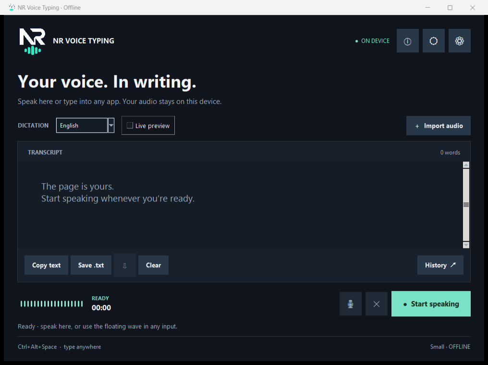

# NR Voice Typing — Offline Voice Typing for Windows

**Version 2.0.0 · English and Dari/Persian · Local Whisper Small · MIT**

NR Voice Typing turns speech into text in its editor or directly inside another
Windows application. After the first setup, normal dictation works locally without
an account, subscription, or cloud speech service.

> **Accuracy status:** the clear English end-to-end sample produced the complete
> expected sentence. English accuracy was good in that test. Dari/Persian support
> is experimental and currently less accurate. No representative Dari accuracy
> percentage has been established. Microphone quality, accent, noise, and nearby
> speakers can change the result.

Developed by **Nooraqa Rasouli — Software Engineer**.
[Developer profile](https://github.com/aryanrasouli491) ·
[Project repository](https://github.com/aryanrasouli491/Offline-Voice-Typing) ·
[MIT License](LICENSE)

## Simple installation

You need Windows 10/11, a microphone, internet access for the first setup, and
**Python 3.12 (64-bit)**. When installing Python from
[python.org](https://www.python.org/downloads/windows/), keep **pip**, **Tcl/Tk**,
and the **Python launcher** enabled.

1. [Download NR Voice Typing v2.0.0](https://github.com/aryanrasouli491/Offline-Voice-Typing/archive/refs/tags/v2.0.0.zip).
2. Extract the ZIP into a normal writable folder such as Documents. Do not run it
   from inside the ZIP or from Program Files.
3. Double-click **Start NR Voice Typing.cmd**.
4. Keep the setup window open during the first run. It downloads only missing
   Python packages and the multilingual Small model (about 484 MB plus metadata).
5. When setup finishes, the app opens automatically. Future starts use the same
   file and open immediately.

That single Start file handles library checks, model setup, installation validation,
and normal launching. Existing compatible packages and a complete model are reused.
Interrupted downloads can be retried by double-clicking Start again.

## Clean download contents

The GitHub ZIP contains only the files needed to run, understand, and legally share
the open-source application:

- **Start NR Voice Typing.cmd** — the only file a normal user needs to double-click.
- **app/** — application source and the required logo.
- **setup/** — first-run dependency/model setup and verification.
- **README.md** — this installation and usage guide.
- **LICENSE** — the complete MIT terms and original developer copyright.
- **.gitignore** — prevents models, libraries, logs, settings, tokens, and history
  from being committed accidentally.

The download does **not** contain a Git repository, virtual environment, model,
personal history, settings, logs, tokens, test suite, generated reports, packaging
tools, or development artifacts. GitHub does not include `.git/` in Download ZIP.

The first run creates two local folders:

- `.venv/` contains local Python packages.
- `runtime/` contains the downloaded model and your private local data.

Both are excluded from GitHub. Do not upload them. Back up `runtime/data/` if you
want to preserve settings and transcript history before moving or reinstalling.

## Everyday use

- Choose **English** or **Dari / فارسی**, then click **Start speaking**.
- Click **Stop & transcribe** to finish immediately.
- After a manual stop, **Resume** appends the next recording. A normal new session
  replaces the editor text.
- The microphone icon mutes recording and immediately transcribes captured speech.
  Unmuting continues the same transcript; muted audio is not stored.
- Focus another application's input and press **Ctrl+Alt+Space** to dictate there.
- Drag the transparent floating wave to save its position. Right-click it to reopen
  the editor or quit the background app.
- Live preview is provisional. Final transcription uses the complete segment.
- Select several History rows with Ctrl/Shift to delete them together.

Balanced recognition now searches five alternatives; Accurate searches eight and
keeps more quiet/accented syllables at phrase edges. Conservative confidence checks
discard strong noise/repetition hallucinations. The conversion bar calibrates itself
per model, language, quality, audio duration, and recent CPU speed. It approaches
99% from measured timing and shows 100% only after conversion actually finishes.

The speech detector rejects non-speech noise, but it is not speaker identification.
It cannot guarantee that a nearby person's voice will be ignored. A close headset
microphone usually gives better results in shared or noisy rooms.

## Save a recording

After stopping, or while muted, click the download arrow beside **Save .txt**.
English and Dari/Persian filenames such as `My meeting` or `صدای من` are supported.
The default format is `voice001_YYYY-MM-DD_HH-MM-SS`.

Recordings are compressed M4A files saved under:

`Music/NR Voice Typing Voices/`

Existing recordings are never overwritten; repeated names receive a number suffix.

## Privacy and security

- Normal speech recognition runs locally after setup.
- Setup connects only to GitHub, Python package sources, and Hugging Face for the
  required source, packages, and public Small model.
- The app runs with ordinary user permissions and does not require administrator access.
- Model loading uses local paths and offline mode during dictation.
- Audio processing and inference queues are bounded to prevent unlimited memory use.
- External text insertion rechecks the destination and preserves Unicode text.
- Clipboard insertion restores the previous clipboard only when the app still owns it.
- History and settings remain under `runtime/data/` on the local computer.
- Downloaded model and third-party packages retain their own upstream licenses.

## Troubleshooting

| Problem | Solution |
| --- | --- |
| Start says Python is missing | Install Python 3.12 (64-bit) with pip, Tcl/Tk, and the launcher, then double-click Start again. |
| A download stops | Check the internet connection and free space, then run Start again. Completed files are reused. |
| The app does not open | Run `Start NR Voice Typing.cmd -Repair` to repeat dependency, model, and installation checks. |
| No microphone input | Enable Windows microphone access for desktop apps and choose the correct device in Settings. |
| Text does not reach another app | Refocus its input and try Clipboard paste or Unicode typing in Settings. A normal app cannot type into an administrator-only window. |
| Shortcut is occupied | Choose another supported shortcut in Settings. |
| No usable model | Run Start with `-Repair`, or select the correct local model folder in Settings. |

Technical errors are written to `runtime/data/app.log`. Logs can contain local file
paths, so inspect them before sharing.

## Open source and copyright

The readable source remains in `app/` and `setup/`; removing development artifacts
does not make the project closed source. Contributions and independent forks are
welcome.

Copyright © 2026 **Nooraqa Rasouli**. This project is released under the
[MIT License](LICENSE). MIT permits use, modification, distribution, private use,
and commercial use, provided the copyright and license notice remain with copies or
substantial portions. Source files also contain an SPDX MIT notice so the original
developer is not lost when files are copied or modified.

Independent forks should identify themselves clearly and must not claim endorsement
by the original developer.

## Repository description and search topics

Suggested description:

> Offline voice typing for Windows. Clear English tested well; Dari/Persian is
> experimental and less accurate. Local Whisper Small. Developed by Nooraqa Rasouli.

Topics: `offline-voice-typing`, `speech-to-text`, `whisper`, `windows`, `python`,
`dari`, `persian`, `accessibility`.

These details improve discoverability, but GitHub controls indexing and search ranking.
